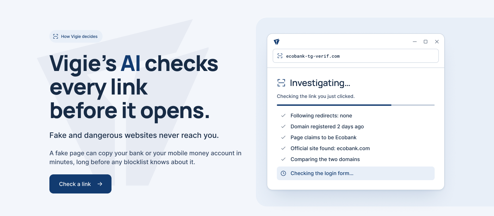
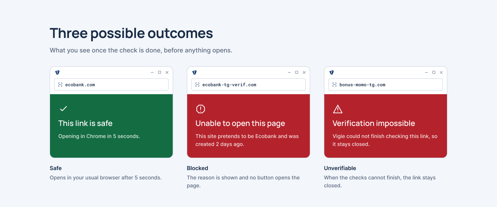
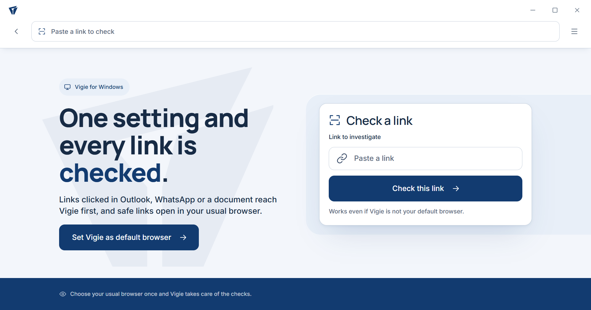

# Vigie

**Vigie’s AI checks every link before it opens, so fake and dangerous websites never reach you.**



> **Video (coming soon):** a 90-second motion design explaining Vigie will be linked here.
>
> **Live demo (coming soon):** `https://vigie.assimti-charles.tech`

---

## The problem

A phishing page can copy a bank or a mobile money account in minutes. Blocklists only learn about it after someone reports it, often days later, and in West Africa many of these pages target mobile money users who receive links by WhatsApp or SMS.

## What Vigie does

When you click a link, Vigie opens first and investigates it while the page stays closed. It finds out which company the page claims to be, looks up that company’s real website, compares the two, and decides.

| Verdict | What you see |
|---|---|
| **Safe** | A green screen, then the link opens in your usual browser after five seconds. |
| **Blocked** | A red screen with the reason, and no button opens the page. |
| **Unverifiable** | The link stays closed and the reason is shown. |



## How Vigie decides

1. **Verdict memory.** A link already judged answers at once, for anyone, for 24 hours.
2. **Case file.** The server gathers the facts in parallel, without any AI: redirects, address signals (lookalike letters, brand names used outside their domain, lure words in French and English), domain age (RDAP, WHOIS, certificate logs), what the page asks for, and the brand’s official website (Wikidata and a checked base of West African brands).
3. **Blocklists.** A link reported by Google Safe Browsing, VirusTotal, URLhaus or OpenPhish is blocked here, and the AI is never called.
4. **AI analyst.** One language model reads the case file and gives a verdict with its reasons, usually in a single step.
5. **Safety rules.** Fixed rules run last and can block a link the AI cleared, never open one it blocked.

## The AI, stated plainly

Vigie does not train its own model. The verdict comes from a commercial language model, **GPT-4.1 mini** (OpenAI), with **Gemini 3.5 Flash** (Google) as a backup. The work in this repository is everything around the model:

- the investigation pipeline and its tools, so the model reasons on measured facts rather than on its memory;
- the case file format, about 1,800 tokens, which keeps one check near US$0.001;
- the rules that can only block, a cost ceiling of US$0.01 per check and US$3 per day;
- adapters for nine AI providers, so a model can be swapped in one line of configuration.

Page text is treated as untrusted data and is never followed as instructions.

## Results

Tested on 14 October 2026 on 120 links: 60 live phishing links from the OpenPhish feed, and 60 real sites (banks, mobile operators and public services of Togo and West Africa, then large services that phishing pages imitate).

| | AI alone (blocklists hidden) | Full Vigie (blocklists, then AI) |
|---|---|---|
| Phishing links blocked | **53 / 60** (88%) | **59 / 60** (98%) |
| Real sites allowed to open | **57 / 60** (95%) | **57 / 60** (95%) |

One check costs **US$0.00076** on average, and the AI answers in **3.2 seconds** on average. The whole test cost US$0.09.

The three real sites wrongly stopped were Bank of Africa, Airtel Africa (blocked) and Binance (unverifiable): this is the main thing to improve, and the user can report any verdict as a mistake. The script is `scripts/evaluate.py`; for phishing links it hides the blocklist results from the model, so the first column measures what the AI catches on its own.

## Where Vigie works

| Platform | Status |
|---|---|
| **Web** | Available. Paste a link, or open a link wrapped with Vigie. |
| **Windows** | Available. Vigie becomes the default browser, so every link clicked in WhatsApp, Outlook or a PDF reaches Vigie first, and safe links open in your usual browser. |
| **Android** | In progress. The screens are designed; the app is being built. |



## Try it

**Windows.** Download `VigieSetup.exe` from the [latest release](../../releases/latest), check its SHA-256 against the value published with the release, and run it. No administrator rights are needed. The installer is not code-signed yet, so Windows SmartScreen shows a warning first (“More info”, then “Run anyway”). `Vigie.exe --uninstall` removes everything.

**Web.** The public demo will be at `https://vigie.assimti-charles.tech`.

**Run the server yourself** (Python 3.13):

```bash
pip install -r requirements.txt
cp .env.example .env          # add an AI key (OpenAI or Gemini) and the threat-intelligence keys you have
python scripts/dev.py         # http://127.0.0.1:8740
```

Without any key, `python scripts/dev.py --test-agent` runs a scripted test agent and shows a “Test mode” banner, and `/replay/ecobank-fake` plays back a recorded investigation. With Docker, `docker compose up -d` runs Vigie behind Caddy for HTTPS.

## Security and privacy

- No account, and only an anonymous token per install for the free daily quota.
- Links that carry a token, such as password reset links, are never sent to VirusTotal or urlscan.io.
- The server never fetches private addresses, keeps no access log, and runs in a read-only container without root.
- API keys live only in `.env`, which is never committed; `scripts/check_secrets.py` runs before every commit.
- The link and the text of the checked page are sent to the AI provider for the analysis, with nothing that identifies the user.

## Repository

```
server/     FastAPI server: investigation pipeline, tools, AI providers, safety rules, web pages
desktop/    Vigie for Windows: pywebview app, Windows integration, installer
scripts/    development server, model evaluation, deployment, secret check
tests/      server, engine and desktop tests (python -m pytest)
data/       recorded demo investigations
```

## Roadmap

- Android app (links tapped or shared to Vigie)
- Code-signed Windows installer
- A public feed of confirmed phishing links for national CERTs
- A Telegram bot

## Author

Essowèréou Charles ASSIMTI ([@en2eav0r](https://github.com/en2eav0r)), cybersecurity, Togo. Licensed under the [MIT License](LICENSE).
